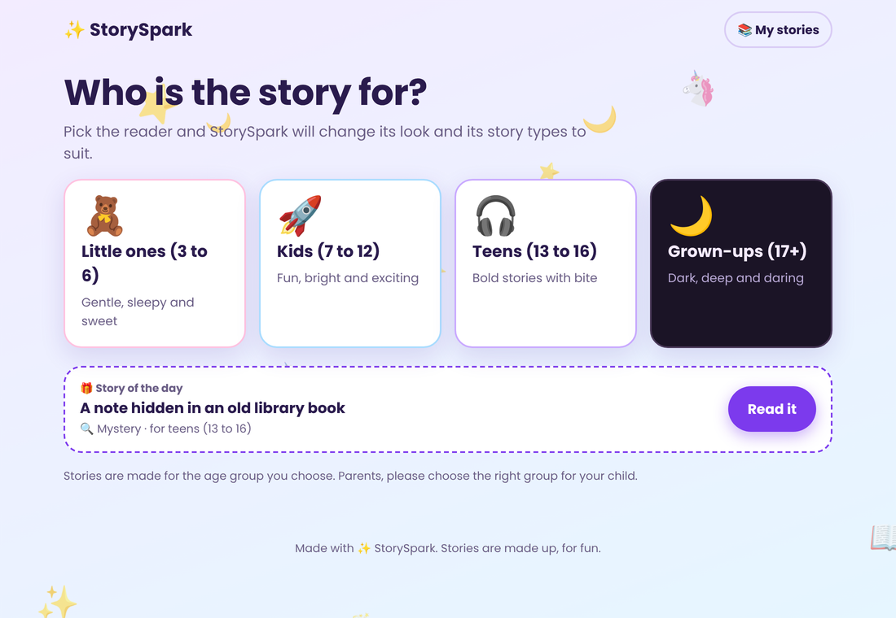
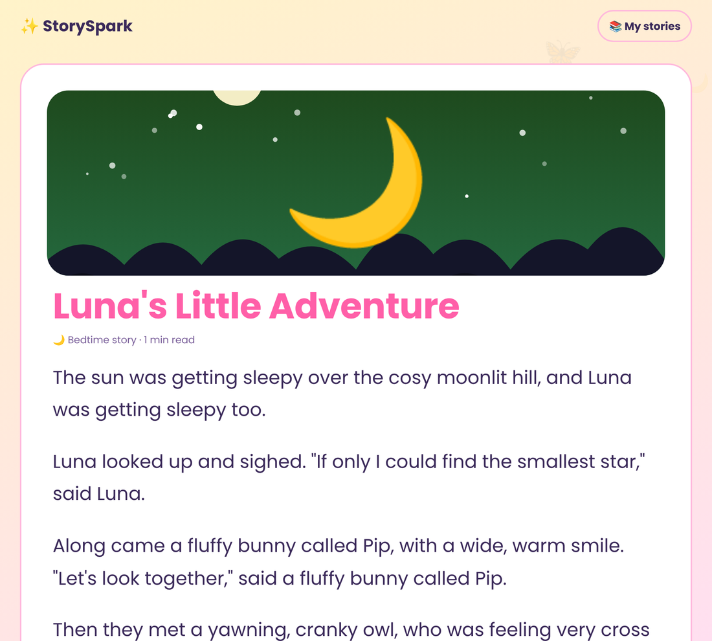
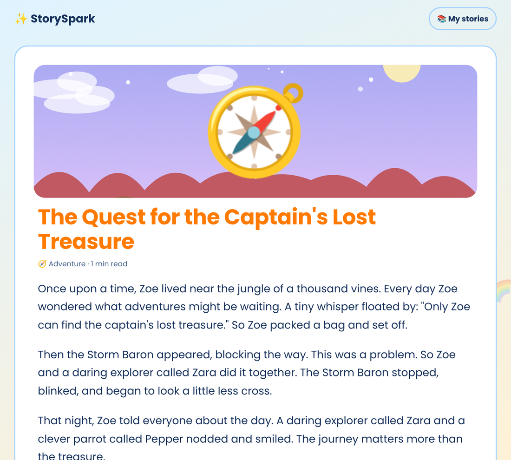
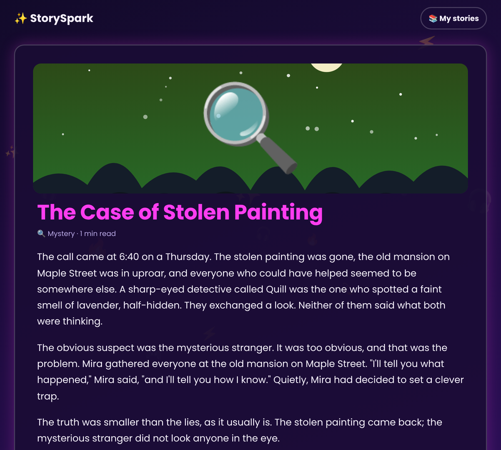
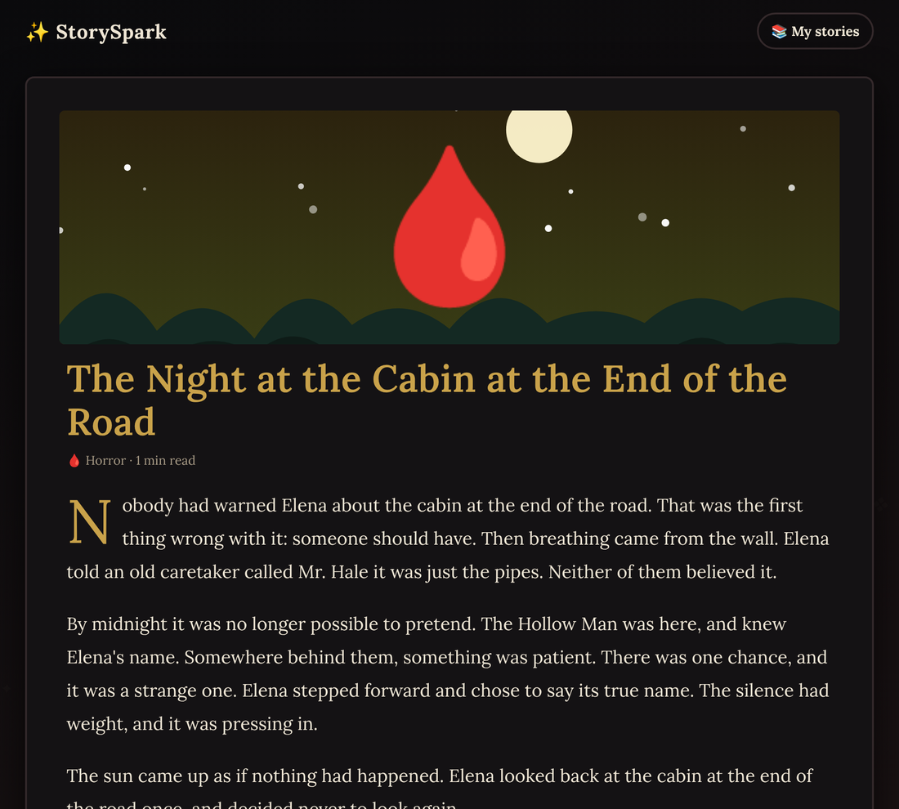
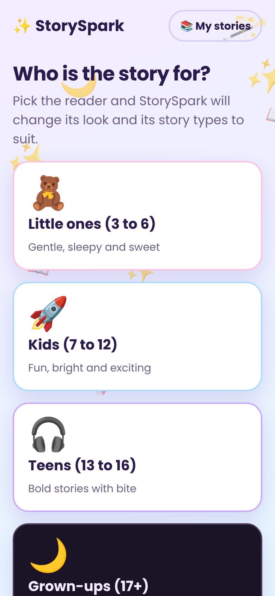
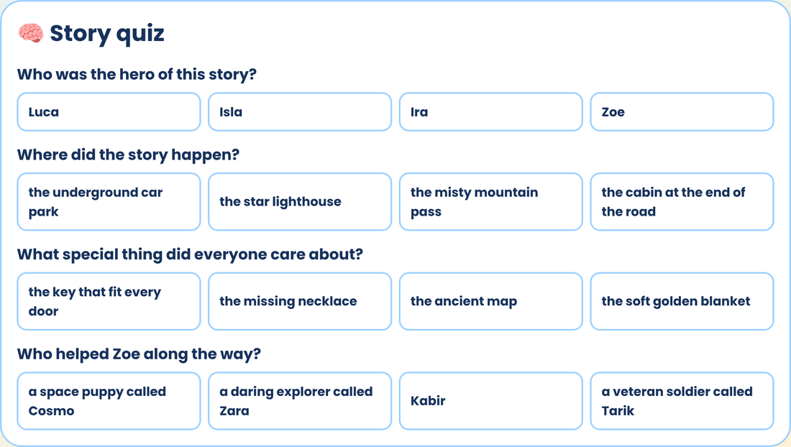

# StorySpark ✨

<p align="center"></p>

## A look inside

The whole app changes its look to match the reader. These are real screenshots.

| Little ones | Kids |
| --- | --- |
|  |  |

| Teens | Grown-ups |
| --- | --- |
|  |  |

| On a phone | Story quiz |
| --- | --- |
|  |  |

## What it does

Type in your characters, pick who the story is for and what kind of story you want. StorySpark writes it.

- **Story of the day:** a fresh idea on the first screen, the same for everyone on a given date.
- **Asks who it's for first:** little ones (3 to 6), kids (7 to 12), teens (13 to 16) or grown-ups (17+). The whole app changes its look, and only offers story types that fit that age group.
- **24 story types:** bedtime, animal friends, fairy tales, silly, kindness and magic for little ones; adventure, fantasy, mystery, space, spooky-not-too-scary and superheroes for kids; romance, dystopian, friendship and more for teens; horror, dark romance, thriller, psychological, drama and historical for grown-ups.
- **Short, medium or long:** long stories come in chapters, and **Keep going** adds another one.
- **Read, listen, keep:** bigger/smaller text, read aloud, copy, and save to **My stories** (kept in the browser).
- **Your own cast:** save characters (💾) and reuse them in any story.
- **Ongoing series:** a new episode with a "Last time" recap; characters can grow up into the next age group.
- **Bedtime mode (little ones and kids):** tell it about today and the story gently winds down to "Goodnight".
- **Sleep mode:** the story is read aloud slowly, with a timer, on a dim screen.
- **PDF and private links:** print or save as PDF; share a read-only link that carries the story in the link itself (nothing is stored on a server).
- **Made for…:** add a dedication like "Aanya, on her birthday" that shows on the story and in the text file.
- **Voice and speed:** pick any voice your device has and how fast it reads.
- **Keep your stories safe:** star favourites, download a story as a text file, and back up or restore your whole library as one file.
- **Photo covers:** romance, dark romance, horror, fantasy, mystery and adventure stories get a real photo cover (files in `covers/`). Other genres keep a drawn scene.
- **Word level:** choose simpler or richer words for any age group. It swaps vocabulary in the built-in maker; it does not rewrite the story.
- **All free:** no accounts, no database, no paid services needed.
- **Works with no setup.** The built-in story maker runs on the device with no network.
- **Optional Magic mode (AI).** Add an `ANTHROPIC_API_KEY` and the app offers one-of-a-kind AI stories. If it fails, or the answer isn't suitable for the age group, it falls back to the built-in maker.

## Run it

```sh
node tests/server.js          # http://localhost:8812
STUB_AI=1 node tests/server.js # same, with a fake AI so you can try Magic mode offline
```

## Deploy (Vercel)

Import the repo as a plain static project. No build step. To turn on Magic mode, add these environment variables in Vercel and redeploy:

| Variable | What |
| --- | --- |
| `ANTHROPIC_API_KEY` | Your Anthropic API key (never put it in the code) |
| `STORY_MODEL` | Optional. Defaults to `claude-haiku-5-5` |
| `STORY_RATE_MAX` | Optional. Stories per visitor per 10 minutes. Defaults to 12 |

AI stories cost money per story, so keep the rate limit and set a spending limit on your Anthropic account.

## Safety by age

- Little ones and kids only get gentle genres. Their stories have no violence, scary or romantic content.
- Teens get no sexual content. Grown-ups get dark themes, but romance stays non-explicit.
- The AI server checks every request (age group and genre must match), cleans character names, and rejects unsuitable answers for little ones and kids.
- An age picker is the reader's own choice. Parents should choose the right group for children.

## Tests

```sh
node tests/unit.js     # engine, genres per age group, AI request + safety checks
python3 tests/e2e.py   # real-browser flow: every age theme, saving, listening controls, Magic mode
```

## Files

```
index.html, styles.css, app.js   the app
story-data.js                    age groups, genres, word lists
story-engine.js                  the built-in story maker
api/story.js, api/_prompt.js     optional AI writer (Vercel function)
vercel.json                      security headers
```
